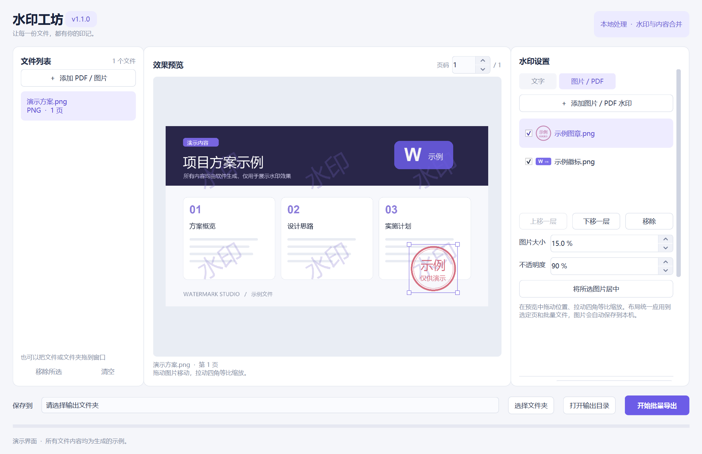
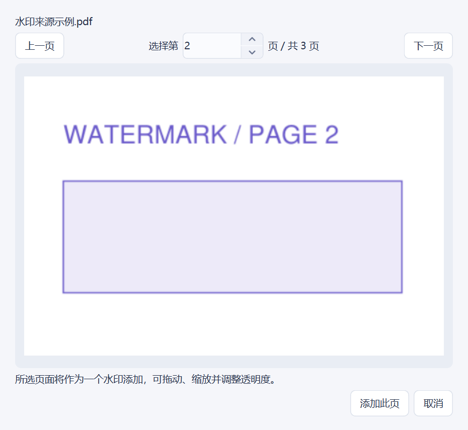
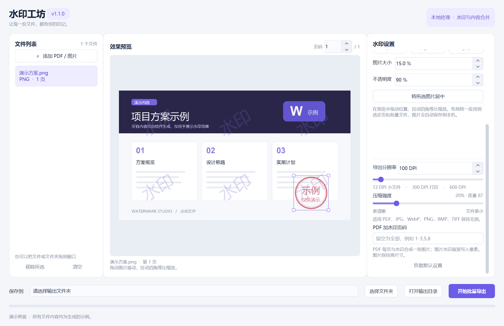

# 水印工坊 v1.1.0 · Watermark Studio

Windows 桌面水印工具，支持 PDF 和常见图片格式。文字、透明图片和所选 PDF 页面可以同时叠加，在预览中拖动位置、拉动四角等比缩放，实时预览、批量导出。

水印直接与页面内容合成为图片像素，PDF 每页包含一张不透明图片，没有独立的水印文字、注释或水印图层。全部文件在本机处理。

**[下载 Windows EXE](https://github.com/lyjxhxn/watermark-studio/releases/download/v1.1.0/watermark-studio-v1.1.0-windows-x64.exe)** · **[下载完整便携包](https://github.com/lyjxhxn/watermark-studio/releases/download/v1.1.0/watermark-studio-v1.1.0-windows-x64.zip)** · [所有版本](https://github.com/lyjxhxn/watermark-studio/releases)



## 功能

- PDF、PNG、JPG/JPEG、BMP、WebP、TIF/TIFF，支持批量添加和拖放。
- 自定义水印文字，支持换行，使用本机已安装字体。
- 文字、图片分别开关；支持多张透明 PNG 等静态图片，独立透明度、位置、大小和叠放顺序。
- PDF 也能作为水印来源：单页直接添加，多页先预览并选择其中一页，可重复添加不同页面。
- 图片可在画布中拖动及四角等比例缩放，布局按相对位置和比例应用到选定页及批量文件。
- 图片自动复制到本机软件数据目录并保存布局，原图移动或删除后仍可继续使用。
- 调整文字大小、颜色、不透明度、角度；支持居中或重复平铺，分别设置行数与列数。
- PDF 页码选择；未加水印的页仍保留，整份 PDF 均按所选 DPI 合成为图片。
- 分辨率支持 72–600 DPI，默认 100 DPI，可使用滑块或数字输入。
- 压缩强度滑块，适用于 PDF、JPG/JPEG、WebP；PNG、BMP、TIFF 保持无损编码。
- 图片保持原像素尺寸，支持透明背景和多页 TIFF。
- 中文菜单、浅色弹窗、圆角颜色图标、清晰的数字增减与下拉箭头。
- 单实例运行：重复启动唤起已有窗口；已有窗口空闲时，追加第二次启动传入的文件。
- 取消导出、失败文件记录、自动编号、保存上次设置；原文件保留。

## 使用

1. 从 [Releases](https://github.com/lyjxhxn/watermark-studio/releases/latest) 下载 EXE，双击运行；无需安装 Python。
2. 添加待处理的 PDF 或图片，在“文字”页设置文字水印，在“图片 / PDF”页添加 Logo、图片或指定 PDF 页面。
3. 查看预览。右侧向下滚动可见分辨率、压缩强度和 PDF 页码设置。
4. 选择输出文件夹，点击“开始批量导出”。

完整说明见 [使用说明](使用说明.md)。发布页同时提供 SHA-256 校验文件。

### 多张图片与 PDF 页面水印

在“图片 / PDF”页选择一张或多张静态图片或 PDF。多页 PDF 会打开选页窗口，预览后指定其中一页；单页 PDF 直接添加。选中 PDF 页面会转换为本机图片副本，保留未绘制区域的透明背景和页面自身内容，不会自动去除页面中绘制的白色背景。转换按最高 300 DPI、最长边 4096 像素生成。



点击列表或画布中的水印后，可拖动移动、拉动四角等比缩放，也可输入占页面宽度的百分比。列表顶部位于最前方，“上移一层 / 下移一层”调整顺序，勾选框控制是否参与导出。

图片保留自身透明通道，再叠加独立不透明度。文字先绘制，图片随后叠加；图片布局统一应用到批量文件。未包含在 PDF 水印页码中的页面不显示图片水印或编辑手柄。导出文件中不会包含选框、缩放手柄或独立水印对象。

关闭重开会恢复图片和布局；图片副本仅保存在本机软件数据目录。缺失或损坏的副本会标红并阻止遗漏导出，可移除后重新添加。恢复默认设置会清空图片列表并清理无引用副本，原始图片保持不变。

### 分辨率与压缩



PDF 的 DPI 决定导出像素数量。提高 DPI 能保留更多细节，也会增加处理时间和体积。图片文件保持原像素尺寸，DPI 用于文字大小换算及可写入格式的 DPI 元数据。

压缩强度越高，PDF、JPG 和 WebP 通常越小，细节也会减少。0% 时 PDF/WebP 使用无损图像编码；PDF 仍会先按所选 DPI 栅格化。预览用于检查水印布局，最终清晰度和压缩效果以导出文件为准。

PDF 栅格化后，可搜索文字、链接、表单和交互元素不会保留。动态 PNG/WebP 暂不支持，支持多页 TIFF。

## 从源码运行

环境：Windows 10/11 x64，Python 3.12。当前 EXE 在 Windows 11 x64 验证。

```powershell
git clone https://github.com/lyjxhxn/watermark-studio.git
cd watermark-studio
python -m venv .venv
.\.venv\Scripts\Activate.ps1
python -m pip install -r requirements.txt --index-url https://pypi.org/simple
python main.py
```

## 检查与打包

```powershell
python -m unittest discover -s tests -v
powershell -ExecutionPolicy Bypass -File build.ps1
```

可执行文件生成于 `dist/水印工坊.exe`。打包配置包含简体中文翻译、SVG 控件图标和运行库处理。所有测试使用临时生成的示例文件。

生成可公开分享的演示截图和完整便携包：

```powershell
python make_demo_assets.py
python package_release.py
```

便携包生成于项目目录旁的 `水印工坊_Windows版.zip`，包含 EXE、源码、说明和许可证。EXE 与 ZIP 通过 GitHub Releases 分发。

## 项目结构

| 文件 | 用途 |
| --- | --- |
| `main.py` | 桌面界面、预览与批量任务 |
| `engine.py` | PDF/图片合成与导出 |
| `single_instance.py` | 单实例锁与窗口激活通信 |
| `image_watermarks.py`、`watermark_canvas.py` | 图片缓存、统一布局与交互画布 |
| `version.py` | 界面、EXE 属性与发布包使用的版本信息 |
| `assets/` | SVG 控件箭头 |
| `tests/` | 导出和单实例进程检查 |
| `水印工坊.spec`、`build.ps1` | Windows EXE 打包 |
| `make_demo_assets.py` | 使用生成的示例内容制作界面截图 |
| `package_release.py` | 整理源码、说明、许可证与便携包 |

## 许可证

源码使用 [AGPL-3.0-or-later](LICENSE)。第三方依赖保留各自许可证，见 [第三方说明](THIRD_PARTY_NOTICES.md)。软件使用系统已安装字体，不包含字体文件。
